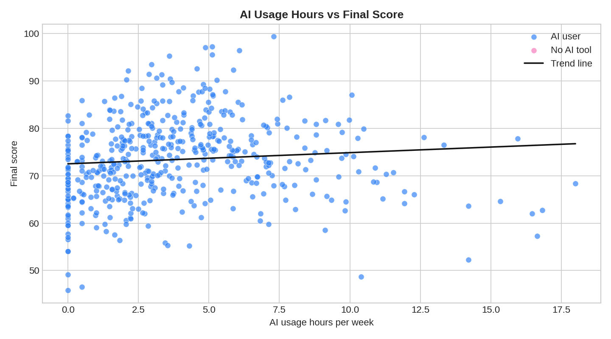
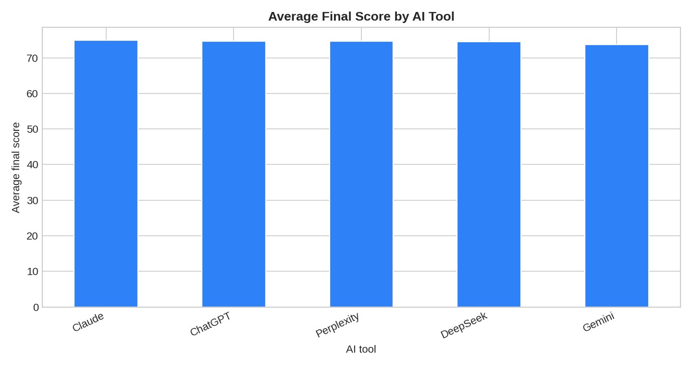
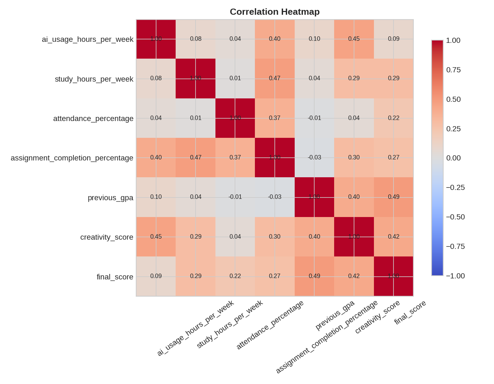

# Student AI Impact Analysis

A complete beginner-friendly **Data Science project** built with **Pandas, NumPy and Matplotlib**. It analyses how students' AI tool usage, study habits, attendance and creativity scores relate to academic performance.

📖 **New here?** Read the full step-by-step explanation of everything in this project: [PROJECT_GUIDE.md](PROJECT_GUIDE.md)

> The dataset in this project is synthetic practice data generated with NumPy. It is made for learning the full workflow: data generation → cleaning → analysis → visualization → insights.

## Project Highlights

- Generate a realistic student dataset with **NumPy**
- Clean and explore data with **Pandas**
- Create summary tables with `groupby`, aggregation and correlation
- Build clear visualizations with **Matplotlib**
- Save charts, tables and written insights automatically

## Questions This Project Answers

1. Which AI tool users have the highest average final score?
2. Does more AI usage mean better performance, or is moderate use better?
3. Which department performs best in the dataset?
4. How do attendance and study hours relate to final score?
5. Is AI usage related to creativity score?

## Dataset Columns

| Column | Meaning |
|---|---|
| `student_id` | Student ID, e.g. STU-001 |
| `gender` | Female / Male |
| `department` | Student department |
| `study_year` | Year of study, 1–4 |
| `ai_tool` | Main AI tool used |
| `ai_usage_hours_per_week` | Weekly AI usage in hours |
| `study_hours_per_week` | Weekly study time |
| `attendance_percentage` | Class attendance percentage |
| `assignment_completion_percentage` | Assignment completion rate |
| `previous_gpa` | Previous GPA |
| `creativity_score` | Creativity score out of 100 |
| `final_score` | Final score out of 100 |
| `performance_level` | Excellent / Good / Average / Needs Improvement |

## Project Structure

```text
student-ai-impact-analysis/
├── README.md
├── requirements.txt
├── data/
│   └── student_ai_dataset.csv
├── src/
│   ├── generate_dataset.py
│   └── analysis.py
├── notebooks/
│   └── student_ai_analysis.ipynb
└── outputs/
    ├── insights.md
    ├── tables/
    │   ├── summary_statistics.csv
    │   ├── average_scores_by_ai_tool.csv
    │   ├── average_scores_by_department.csv
    │   ├── average_scores_by_ai_usage_level.csv
    │   └── correlation_matrix.csv
    └── charts/
        ├── ai_usage_vs_final_score.png
        ├── average_final_score_by_ai_tool.png
        ├── creativity_score_distribution.png
        ├── average_final_score_by_department.png
        ├── performance_by_ai_usage_level.png
        └── correlation_heatmap.png
```

## Quick Start

```bash
git clone <your-repository-url>
cd student-ai-impact-analysis
pip install -r requirements.txt
python src/generate_dataset.py
python src/analysis.py
```

After running the analysis, open:

- `outputs/insights.md` for the key findings
- `outputs/charts/` for all visualizations
- `outputs/tables/` for the summary CSV files

## Sample Visualizations







## Tools Used

- **Python**
- **Pandas** — data cleaning, grouping and analysis
- **NumPy** — synthetic data generation, trend line and numerical work
- **Matplotlib** — charts and heatmap

## Future Improvements

- Replace the synthetic dataset with a real student survey dataset
- Add a Jupyter notebook walkthrough for presentation
- Train a simple Machine Learning model with scikit-learn to predict final score
- Build an interactive dashboard with Streamlit

## Note

This project is for Data Science practice. Correlation in this dataset does not prove causation.
